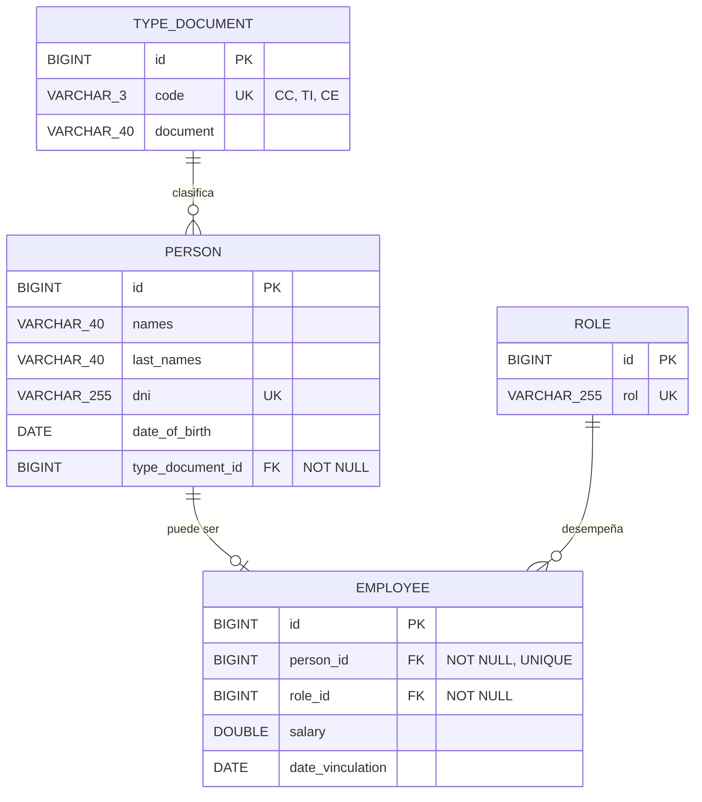
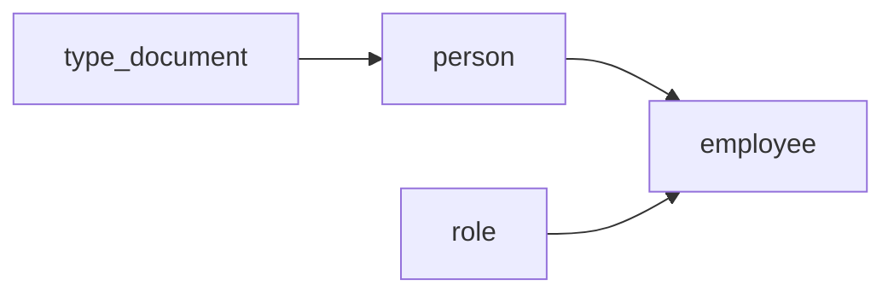

# 📦 Prueba Técnica Developer - Parameta S.A.S

Este proyecto es una implementación de un servicio REST desarrollado en **Java 25** utilizando **Spring Boot**. El objetivo es recibir información de un empleado, validar los datos, consultar un servicio SOAP y almacenar los datos en una base de datos. Finalmente, retorna un JSON con información calculada adicional.

---

## 🧩 Descripción del problema

Se requiere exponer un servicio REST que reciba un objeto **Empleado** con los siguientes atributos:

- Nombres (`String`)
- Apellidos (`String`)
- Tipo de Documento (`String`)
- Número de Documento (`String`)
- Fecha de Nacimiento (`Date`)
- Fecha de Vinculación a la Compañía (`Date`)
- Cargo (`String`)
- Salario (`Double`)

### Requisitos funcionales:

- Validar que los campos no vengan vacíos y que las fechas estén en formato válido.
- Validar que el empleado sea **mayor de edad**.
- Invocar un servicio **SOAP** con la información del empleado.
- Almacenar los datos en una base de datos **MySQL**.
- El servicio REST debe responder con un JSON que incluya:
  - Edad actual del empleado (**años, meses y días**).
  - Tiempo de vinculación a la empresa (**años, meses y días**).


## ⚙️ Tecnologías utilizadas

- Java 25
- Spring Boot 3.5
- Spring Web
- Spring Data JPA
- Bean Validation (`@Valid`)
- Docker & Docker Compose
- MySQL 8 / Swagger
- Consumo de servicios SOAP
- Lombok

# Explicación de la solución

Este proyecto contiene dos microservicios que interactúan a través de un servicio SOAP:

1. **ws-soap - Exposición del servicio SOAP**: Este microservicio expone un servicio SOAP.
2. **parameta - Consumo del servicio SOAP**: Este microservicio consume el servicio SOAP expuesto por el primer ws-soap.

## Estructura del Proyecto

### Microservicio ws-soap: Servicio SOAP

Este microservicio expone un servicio SOAP que proporciona funcionalidad relacionada con el registro de empleados. Los detalles del servicio están definidos en el archivo WSDL y el servicio está implementado utilizando Spring Boot y Spring Web Services.

- **Paquete:** `com.soap`
- **Puntos clave:**
  - Exposición del servicio SOAP a través de un endpoint.
  - Validación de solicitudes y manejo de excepciones.
  - Persistencia de datos a través de JPA y base de datos.

### Microservicio 2 parameta: Cliente SOAP

Este microservicio consume el servicio SOAP expuesto por el Microservicio ws-soap. Se comunica con el microservicio que expone el servicio SOAP utilizando un cliente SOAP generado a partir del WSDL.

- **Paquete:** `parameta.demo.parameta`
- **Puntos clave:**
  - Generación del cliente SOAP a partir del archivo WSDL.
  - Llamada al servicio SOAP utilizando el cliente generado.
  - Manejo de respuestas y errores.


## 🏗️ Arquitectura y patrones implementados

### 🧱 Patrón por Capas (Layered Architecture)
Separación clara de responsabilidades:

El proyecto sigue una arquitectura por capas, promoviendo la separación de responsabilidades y el mantenimiento del código. A continuación, se describen los componentes principales:

- **Controller:** Maneja las solicitudes y respuestas HTTP. Es la capa de entrada al sistema, delegando la lógica de negocio a los servicios.

- **Service:** Define la interfaz de los servicios. Representa la abstracción de las operaciones del negocio.

- **ServiceImpl:** Implementación concreta de los servicios. Contiene la lógica de negocio y coordina las operaciones entre los diferentes componentes.

- **Repository:** Capa encargada del acceso a datos. Utiliza Spring Data JPA para facilitar la comunicación con la base de datos.

- **Entities:** Representan el modelo de datos de la aplicación. Estas clases están mapeadas a las tablas de la base de datos utilizando anotaciones JPA.

- **DTOs (Data Transfer Objects):** Objetos de transferencia de datos. Permiten encapsular y transportar datos entre capas, desacoplando la representación interna de las entidades del modelo de dominio.


## 📚 Modelo de Datos

Este proyecto incluye un modelo de datos orientado a representar una estructura básica de empleados, personas, roles y tipos de documento.

### 🗺️ Diagrama Entidad-Relación (MySQL)



### 🔄 Dependencias y orden de creación



- `type_document` y `role` son **tablas de referencia**: no dependen de ninguna otra y deben existir primero (se cargan con la migración `V2`).
- `person` depende de `type_document` (`type_document_id`).
- `employee` depende de `person` y de `role`. Su `person_id` es único, por lo que una persona tiene **máximo una** vinculación laboral.
- Por esta jerarquía, para dar de alta un empleado la persona debe existir antes (se busca por `dni`). Al borrar, el orden inverso aplica: `DELETE FROM employee` no afecta a las demás tablas, pero no se puede borrar una persona, rol o tipo de documento que tenga registros dependientes.

### 🔗 Relaciones entre Entidades

- **`PersonEntity` — `TypeDocumentEntity`**  
  Relación de muchos a uno (`@ManyToOne`).  
  Muchas personas pueden tener el mismo tipo de documento.

- **`PersonEntity` — `EmployeeEntity`**  
  Relación uno a uno (`@OneToOne`).  
  Una persona puede estar asociada a un empleado.

- **`EmployeeEntity` — `RoleEntity`**  
  Relación de muchos a uno (`@ManyToOne`).  
  Muchos empleados pueden compartir un mismo rol.

- **`RoleEntity` — `EmployeeEntity`**  
  Relación inversa de la anterior (`@OneToMany`).  
  Un rol puede estar asociado a múltiples empleados.
  

## Ejecución local con Docker Compose

Requisitos: Docker Compose y Docker instalados.

1. Copia `.env.example` a `.env` y ajusta las credenciales si es necesario.
2. Desde la raíz del proyecto, ejecuta:

```bash
docker compose up --build
```

Compose espera a que MySQL y SOAP estén saludables antes de iniciar el consumidor REST. El servicio SOAP aplica las migraciones Flyway y carga los datos de prueba de forma idempotente. No compartas ni subas el archivo `.env`. El usuario de base de datos no puede ser `root` (restricción de la imagen de MySQL).

Servicios:

- REST: `http://localhost:8080`
- Swagger UI: `http://localhost:8080/swagger-ui`
- SOAP WSDL: `http://localhost:8081/ws/employee.wsdl`
- Estado de la API: `http://localhost:8080/actuator/health`

### Crear una persona

`POST http://localhost:8080/api/person` (`Content-Type: application/json`):

```json
{
  "names": "Ana",
  "lastNames": "Prueba",
  "typeDocument": {
    "id": 1,
    "code": "CC",
    "document": "Cédula de Ciudadanía"
  },
  "dni": "123456789",
  "dateOfBirth": "1990-01-01"
}
```

Para las pruebas de alta de empleado se puede usar el DNI ya sembrado `100000001`, o registrar uno nuevo mediante este endpoint.

### Crear y eliminar una vinculación laboral

La creación es `POST http://localhost:8080/api/employee/create` (`Content-Type: application/json`). Requiere que la persona ya exista y que los IDs de tipo de documento y rol correspondan a registros existentes:

```json
{
  "names": "Juan",
  "lastNames": "Perez",
  "typeDocumentDTO": {
    "id": 1,
    "code": "CC",
    "document": "Cédula de Ciudadanía"
  },
  "dni": "100000001",
  "dateOfBirth": "1990-01-01",
  "employeeDTO": {
    "roleDTO": {
      "id": 1,
      "rol": "Desarrollador"
    },
    "salary": 3500000,
    "dateVinculation": "2025-01-15"
  }
}
```

Para limpiar los registros de empleado de la base local y volver a ejecutar las pruebas de alta, conecta a MySQL:

```powershell
docker compose exec mysql sh -c 'mysql -u"$MYSQL_USER" -p"$MYSQL_PASSWORD" "$MYSQL_DATABASE"'
```

En el prompt de MySQL, ejecuta:

```sql
DELETE FROM employee;
```

Esto elimina **todos los registros de empleados**, pero conserva personas, roles y tipos de documento. Luego puedes volver a enviar el `POST` de alta para cualquiera de las personas existentes. Esta acción es permanente; verifica que estás conectado a la base de pruebas antes de ejecutarla.

### Ejecutar pruebas

Desde la raíz del repositorio, en Windows:

```powershell
.\parameta\mvnw.cmd -f .\parameta\pom.xml test
.\ws-soap\mvnw.cmd -f .\ws-soap\pom.xml test
```